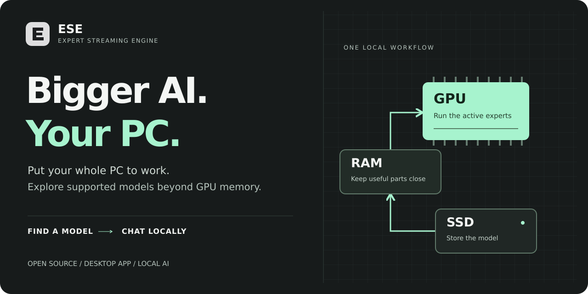
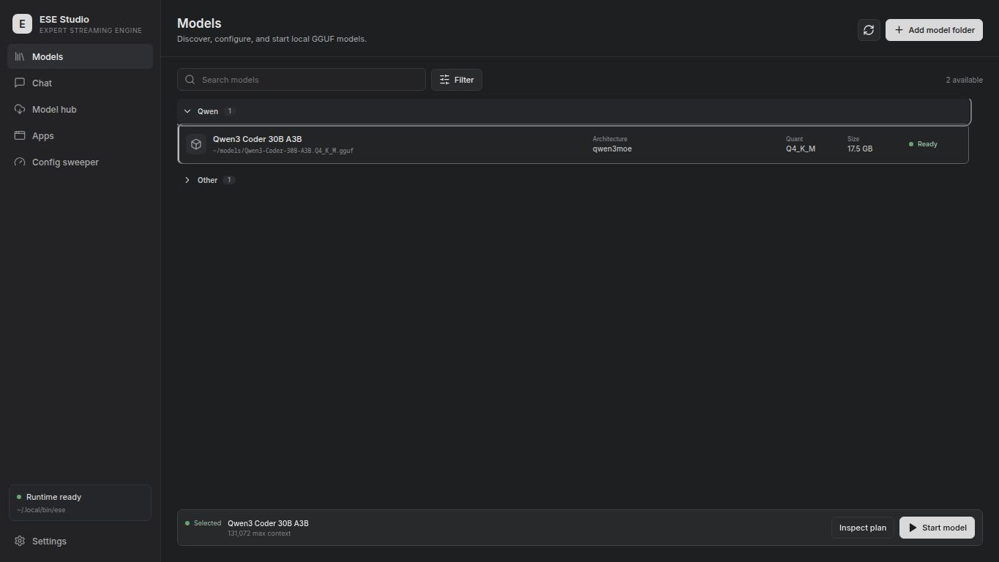
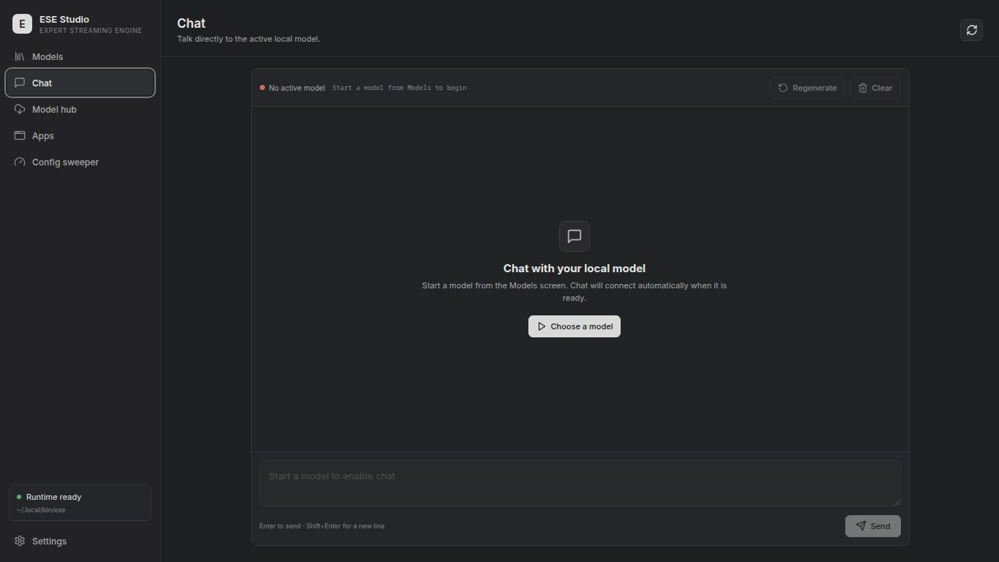
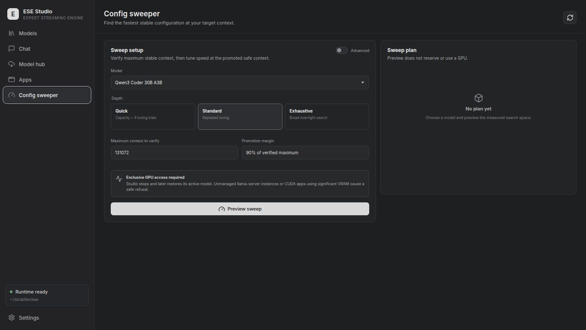

<picture>
  <source media="(max-width: 600px)" srcset="docs/brand/ese-hero-mobile.svg">
  
</picture>

# ESE · Bigger AI. The PC you already own.

**Find a model. Start a conversation. Explore what your machine can do.**

Expert Streaming Engine (ESE) brings local AI to a desktop app. Browse models,
chat on your own computer, and explore larger supported models by putting your
SSD, system memory and NVIDIA graphics cards to work together. CPU-only
packages are available too.

**[Start here →](docs/START_HERE.md)** ·
[See the app](#meet-ese-studio) ·
[What can my PC run?](docs/WHAT_CAN_MY_PC_RUN.md) ·
[Downloads](https://github.com/xero00000/expert-streaming-engine/releases)

[](https://github.com/xero00000/expert-streaming-engine/releases/latest)
[](https://github.com/xero00000/expert-streaming-engine/actions/workflows/ese-ci.yml)
[](LICENSE)

## Your graphics card is only part of the story

A large AI model can take more memory than your graphics card has. ESE can keep
supported models' specialist weights on your SSD and move the parts in use
through RAM and GPU memory. This is called **expert streaming**.

That opens up more model choices on the hardware you already have. The tradeoff
is speed: your model, available memory and SSD determine how quickly it can
answer. The streaming advantage applies to supported sparse models, also called
**Mixture of Experts (MoE)** models. Dense models use ordinary placement.

| You want to… | ESE helps you… |
| --- | --- |
| Try local AI without starting at a terminal | Browse a model library and chat in ESE Studio |
| Explore models beyond your GPU's memory | Share the work across SSD, RAM and NVIDIA GPUs for supported sparse models |
| Spend less time guessing settings | Inspect a launch plan and measure configurations on your own PC |
| Keep local conversations on your machine | Chat with the local model server; benchmark sharing is optional and off by default |

## Meet ESE Studio

Your model library, chat and tuning tools in one desktop app.



**Find your next model.** Search the Model hub or add a folder of models you
already own. See model sizes and memory-fit recommendations before downloading.

**Talk to it locally.** Start a supported model, open Chat, and keep your
conversation history on your computer.

**Find settings worth keeping.** The Config sweeper tries real launches and
measures the results. Save a verified profile for next time.

<details>
<summary>See the chat and configuration screens</summary>

### Local chat



### Configuration sweeper



These are actual interface captures. The empty chat screen shows the starting
state; it is not a generated conversation or performance demonstration.

</details>

## Start here

1. **Choose your package.** Use the [installation guide](docs/install.md) to
   pick Windows, Linux CPU, or Linux NVIDIA CUDA.
2. **Add a model.** Open Studio's Model hub, or add your existing GGUF model
   folder in Models. GGUF is the model-file format ESE reads.
3. **Start a conversation.** Review the launch plan, start the model, and open
   Chat. Begin with a model and context size that fit your available memory.

The [beginner guide](docs/START_HERE.md) walks through your first launch and
explains the unfamiliar terms along the way.

**Release status:** the v0.2.1 desktop installers are prepared and locally
checked; publication is pending. The latest published release may be older.
Always use the instructions, package and checksums for the version you download.

| Your system | v0.2.1 candidate package |
| --- | --- |
| Windows x64 | `ESE-Studio_0.2.1_windows-x64-setup.exe` or MSI; both include CPU and CUDA runtimes |
| Linux x86_64, CPU | `ESE-Studio_0.2.1_linux-x86_64_cpu.AppImage`, DEB or RPM |
| Linux x86_64, NVIDIA | The matching `_cuda` AppImage, DEB or RPM; compatible NVIDIA driver required |

Windows installation, CPU fallback and signed NSIS update checks pass locally.
Physical Windows NVIDIA inference is deferred and remains unqualified. Windows
installers lack Authenticode signatures; updater signatures are separate.
[Installation and update details →](docs/install.md)

## Bigger models, with the receipts

An earlier engineering run loaded **GPT-OSS 120B F16 — roughly 61 GiB of model
weights — with about 18 GiB of combined GPU memory** across two NVIDIA cards,
about 47 GiB of usable system RAM, and NVMe storage. Recorded short-context
generation was about **11.5 tokens per second** on that machine.

That is a specific historical result, with its own model and settings. It gives
a concrete example of memory beyond the GPU; it does not predict your PC's
speed. [See the hardware, timings and limits](docs/ESE_BENCHMARKS.md#gpt-oss-120b-f16).

The selected experimental Flash-Next profile currently reaches about 19 tok/s
in short diagnostic repeats. Its production admission remains disabled; it is
not a beginner model recommendation. Long-context and extended workload checks
are deferred. [Current candidate scope](docs/RELEASE_CANDIDATE_REVIEW_20261021.md).

## A few things to know before you download

- **Model choice matters.** An estimated memory fit is a starting point; the
  exact model, file variant and workload still need a real run. Experimental
  Qwen4Exp text inference stays disabled in production; vision and MTP on that
  path are unsupported.
- **Local chat stays local.** Model searches and downloads contact Hugging Face;
  update checks contact GitHub. External apps use their own services and
  privacy settings. Optional sharing sends sanitized benchmark summaries,
  never your prompts or responses.
- **Start with the supported desktop path.** Linux and Windows x86_64 packages
  are prepared. Linux CUDA checks cover the recorded NVIDIA hardware; Windows
  GPU inference, AMD/Intel acceleration and macOS are not qualified by this
  candidate. [Check your PC](docs/WHAT_CAN_MY_PC_RUN.md).

## Prefer the command line?

From a source checkout:

```bash
./ese doctor
./ese build                    # uses CUDA when available; CPU otherwise
./ese plan /models/model.gguf  # inspect the plan
./ese serve /models/model.gguf # start the local server
```

Windows source users can use `ese.cmd`; installed Windows packages include
`ese.exe`. See the [engineering guide](docs/ENGINEERING_GUIDE.md) for build
requirements, policies, native controls, API access and measured results.

## Go deeper

[Studio guide](studio/README.md) ·
[Profiles and tuning](docs/ESE_PROFILES.md) ·
[Architecture](docs/ESE_ARCHITECTURE.md) ·
[Build from source](docs/build.md) ·
[Reference benchmarks](docs/ESE_BENCHMARKS.md) ·
[Community benchmarks](COMMUNITY_BENCHMARKS.md) ·
[Changelog](CHANGELOG.md) ·
[Contributing](CONTRIBUTING.md)

If ESE helps you explore what your PC can do, star the project or share a
reproducible result. Found a problem? [Open an issue](https://github.com/xero00000/expert-streaming-engine/issues/new/choose)
with your model, hardware and steps to reproduce it.

ESE is MIT licensed and builds on `ik_llama.cpp` and `llama.cpp`, with their
original attribution retained. Bundled NVIDIA components have separate terms;
see [third-party notices](THIRD_PARTY_NOTICES.txt). [Branch policy](docs/BRANCH_POLICY.md).
